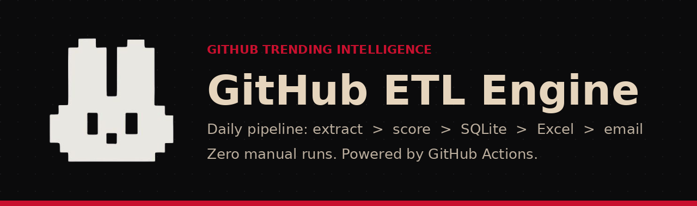
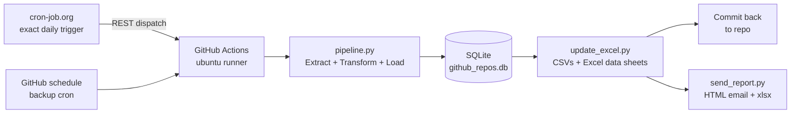

<div align="center">



<br>

[](https://github.com/DishantBhere/GitHub-ETL-Engine-V2/actions/workflows/schedule.yml)


### Tracks what is blowing up on GitHub. Every day. Hands free.

[](https://dishantbhere.github.io/GitHub-ETL-Engine-V2/)

[](https://dishantbhere.github.io/GitHub-ETL-Engine-V2/)
[](#overview)
[](#dashboard-preview)
[](#design)
[](#live-links)
[](#architecture)
[](#quick-start)
[](#deep-dive)

</div>

<br>

## Overview

Every day the pipeline asks the GitHub Search API for the most starred repositories created in the last 30 days. It cleans and scores them, upserts them into SQLite, rebuilds an Excel dashboard, commits the fresh files back to this repo and emails you a styled report. No server. No manual runs. No paid service.

<table>
<tr>
<td align="center" width="25%"><h3>Top 500</h3>new repos pulled<br>per run, by stars</td>
<td align="center" width="25%"><h3>6 tables</h3>languages, tiers,<br>velocity, topics...</td>
<td align="center" width="25%"><h3>8 charts</h3>in a hand designed<br>Excel dashboard</td>
<td align="center" width="25%"><h3>1 email</h3>HTML report with<br>workbook attached</td>
</tr>
</table>

**You get**

- **Live website** with pipeline walkthrough, dashboard preview and downloads: [open site](https://dishantbhere.github.io/GitHub-ETL-Engine-V2/)
- **Excel dashboard** with KPIs, top repos, language mix, velocity, topics and activity
- **CSV exports** in `data/`
- **SQLite database** (`github_repos.db`) that keeps history
- **Daily HTML email** with top 5, fastest risers and language mix

---

## Dashboard preview

<div align="center">

<br><br>

<br><br>

<br><br>

</div>

## Daily email 📩

<div align="center">

</div>

---

## Design

<div align="center">

</div>

Black, ivory and red. Same palette across the logo, README, Excel dashboard and daily email.

---

## Live links

<div align="center">

[](https://dishantbhere.github.io/GitHub-ETL-Engine-V2/)
[](https://github.com/DishantBhere/GitHub-ETL-Engine-V2/blob/main/GitHub_Trending_Dashboard.xlsx)
[](https://github.com/DishantBhere/GitHub-ETL-Engine-V2/tree/main/data)
[](https://github.com/DishantBhere/GitHub-ETL-Engine-V2/actions)
[](https://console.cron-job.org/jobs)

</div>

---

## Architecture



| Stage | File | What happens |
|:--|:--|:--|
| **Extract** | `pipeline.py` | `GET /search/repositories`, repos created in last `DAYS_BACK` days, sorted by stars, 5 pages x 100 |
| **Transform** | `pipeline.py` | Clean fields, convert to IST, add derived metrics, drop duplicates |
| **Load** | `pipeline.py` | Upsert into `repos` table, keyed on `url` |
| **Report** | `update_excel.py` | Build 6 summary tables, write CSVs, inject data into workbook |
| **Notify** | `send_report.py` | Send HTML email with workbook attached |
| **Orchestrate** | `schedule.yml` | Run everything, upload artifact, commit results |

### Derived metrics

| Metric | Formula | Meaning |
|:--|:--|:--|
| `stars_per_hour` | `stars / max(age_hours, 1)` | How fast a repo is rising |
| `fork_ratio` | `forks / max(stars, 1)` | People build on it, not just bookmark it |
| `age_hours` / `age_days` | time since creation | Base for velocity |
| `viral_level` | tier from stars | Quick popularity bucket |

### Viral tiers

| Stars | Tier | Stars | Tier |
|:--|:--|:--|:--|
| 25,000+ | **Hall of Fame** | 500+ | **Rising Star** |
| 10,000+ | **Legendary** | 100+ | **Trending** |
| 5,000+ | **Iconic** | 50+ | **Popular** |
| 2,500+ | **Super Viral** | below 50 | **Normal** |
| 1,000+ | **Viral** | | |

---

## Quick start

<details>
<summary><b>Run it locally</b></summary>

<br>

```bash
git clone https://github.com/DishantBhere/GitHub-ETL-Engine-V2.git
cd GitHub-ETL-Engine-V2
pip install -r requirements.txt
python run_all.py
```

Open `GitHub_Trending_Dashboard.xlsx`. Done.

`run_all.py` runs `pipeline.py` then `update_excel.py`, stops on first failure. Close the workbook in Excel before running.

Preview the email without sending:

```bash
DRY_RUN=1 STATUS=success TRIGGER=manual REPO=you/repo RUN_URL=https://example.com python send_report.py
```

Writes `email_preview.html`. Open in a browser.

</details>

---

## Scheduling design

GitHub's own `schedule` cron is best effort. Runs start late or get skipped. Two triggers fix that:

| Trigger | Role | How |
|:--|:--|:--|
| [**cron-job.org**](https://console.cron-job.org/jobs) | Primary, exact time | `POST` to workflow dispatch API |
| **GitHub `schedule`** | Backup | `30 19 * * *` UTC = 01:00 IST |

```
POST https://api.github.com/repos/DishantBhere/GitHub-ETL-Engine-V2/actions/workflows/schedule.yml/dispatches
Body: {"ref":"main"}
```

A `concurrency` group (`daily-etl`) stops overlapping runs. Both triggers firing same day = two commits. Harmless, load is an upsert.

---

## Deploy your own copy

<details>
<summary><b>Setup steps</b></summary>

<br>

1. Fork or clone this repo.
2. **Settings > Secrets and variables > Actions > Repository secrets**, add:

   | Secret | Value |
   |:--|:--|
   | `MAIL_USER` | Gmail address that sends the report |
   | `MAIL_PASS` | Gmail **app password** (16 chars, needs 2 Step Verification) |
   | `MAIL_TO` | Address that receives the report |

3. **Settings > Actions > General > Workflow permissions** > **Read and write permissions**.
4. **Actions** tab > **Daily GitHub ETL** > **Run workflow** once to test.
5. For exact schedule, create a cron-job.org job calling the dispatch URL above:
   - `Authorization: Bearer <fine grained token>`
   - `Accept: application/vnd.github+json`
   - `X-GitHub-Api-Version: 2022-11-28`
   - `Content-Type: application/json`
   - Token scope: only this repo, **Actions: Read and write**
6. Change repo path in dispatch URL and badge.

> Never commit tokens or passwords. Keep them in Secrets or the cron-job.org header field.

</details>

---

## Project structure

<details>
<summary><b>File tree</b></summary>

<br>

```
GitHub-ETL-Engine-V2/
├── .github/workflows/schedule.yml   # automation
├── assets/
│   ├── banner.png                   # README banner
│   ├── design.png                   # logo + palette
│   ├── icons/                       # gmail, linkedin, telegram, github svg
│   └── dashboard_template.xlsx      # master dashboard design
├── docs/                            # live website (GitHub Pages)
├── data/                            # CSV exports
│   ├── repos.csv
│   ├── languages.csv
│   ├── categories.csv
│   ├── velocity.csv
│   ├── topics.csv
│   └── activity.csv
├── pipeline.py                      # extract, transform, load
├── update_excel.py                  # CSVs + Excel data sheets
├── send_report.py                   # HTML email
├── build_template.py                # manage master design
├── run_all.py                       # run everything locally
├── github_repos.db                  # SQLite database
├── GitHub_Trending_Dashboard.xlsx   # generated dashboard
├── download-Photoroom.png           # project logo
├── requirements.txt
└── LICENSE
```

</details>

---

## Deep dive

<details>
<summary><b>Configuration reference</b></summary>

<br>

| Variable | Default | Used by | Purpose |
|:--|:--|:--|:--|
| `DAYS_BACK` | `30` | pipeline, update_excel | Look-back window for new repos |
| `TIMEZONE` | `Asia/Kolkata` | pipeline | Date/time columns. `UTC` for raw |
| `DB_PATH` | `github_repos.db` | pipeline, update_excel | SQLite location |
| `GITHUB_TOKEN` | none | pipeline | Raises API rate limit |
| `LATEST_ONLY` | `1` | update_excel | `1` newest load only, `0` all DB rows |
| `DATA_DIR` | `data` | update_excel | CSV output folder |
| `TEMPLATE_PATH` | `GitHub_Trending_Dashboard.xlsx` | update_excel, build_template | Output workbook |
| `DESIGN_SRC` | `assets/dashboard_template.xlsx` | update_excel, build_template | Master design |
| `DRY_RUN` | unset | send_report | `1` writes `email_preview.html` only |
| `MAIL_USER` `MAIL_PASS` `MAIL_TO` | none | send_report | Gmail sender, app password, recipient |

</details>

<details>
<summary><b>Pipeline stages in detail</b></summary>

<br>

**Extract**
- Query `created:>{today - DAYS_BACK}`, `sort=stars`, `order=desc`, `per_page=100`
- Up to 5 pages = top 500. Stops early if page has fewer than 100 items
- Uses `Authorization: Bearer $GITHUB_TOKEN` when set
- `raise_for_status()` on every request. Empty result exits with code 0

**Transform**
- Missing language becomes `Unknown`. Topics list becomes comma string
- Repos with **no description are dropped**. Duplicate URLs dropped
- UTC converted to `TIMEZONE`, split into `dd-mm-yy` date and `hh:mm AM/PM` time
- Sorted by stars, `rank` 1..N

**Load**
1. Create `repos` table if missing, add any missing columns (auto migrate)
2. Write batch to temp table
3. Delete rows whose `url` is in the batch, insert batch (upsert)
4. Drop temp table
5. Re-apply `viral_level` tiers to **every** row with one SQL `UPDATE`

Repos that fall out of the top 500 stay in the DB as history.

**Report**
- Reads newest load only by default (`LATEST_ONLY=1`), recomputes `rank`
- Frames: repos, languages, viral categories, velocity (top 10), topics (top 10), activity (Today, 1-2 days, 3-7 days, 8+ days)

</details>

<details>
<summary><b>Database schema</b></summary>

<br>

Single table `repos`. Upsert key: `url`.

| Column | Type | Notes |
|:--|:--|:--|
| `rank` | INTEGER | Position by stars in the load |
| `name`, `owner` | TEXT | Repo name, owner login |
| `owner_type` | TEXT | `User` or `Organization` |
| `stars`, `forks`, `open_issues` | INTEGER | Counts |
| `viral_level` | TEXT | Tier |
| `language` | TEXT | `Unknown` if none |
| `topics` | TEXT | Comma separated |
| `license` | TEXT | SPDX id |
| `description` | TEXT | Never null |
| `url` | TEXT | Unique repo URL |
| `is_fork`, `is_archived` | INTEGER | 0 or 1 |
| `created_at` `created_time` | TEXT | `dd-mm-yy`, `hh:mm AM/PM` |
| `pushed_at` `pushed_time` | TEXT | Same format |
| `age_hours` | INTEGER | |
| `age_days`, `stars_per_hour`, `fork_ratio` | REAL | |
| `loaded_at` `loaded_time` | TEXT | When the run loaded the row |

```sql
SELECT name, owner, stars, stars_per_hour
FROM repos
ORDER BY stars_per_hour DESC
LIMIT 10;
```

</details>

<details>
<summary><b>Excel dashboard design</b></summary>

<br>

| Sheet | Purpose |
|:--|:--|
| `Dashboard` | Hand designed layer: KPIs, 8 charts, images, picture links |
| `Repo_Data` | Full repo table (`tblRepos`) |
| `Language_Data` | Repos, stars, avg stars, velocity per language |
| `Category_Data` | Repo count per viral tier |
| `Velocity_Data` | Top 10 by stars per hour |
| `Topic_Data` | Top 10 topics |
| `Activity_Data` | Last push buckets |
| `Config` | Load timestamp `B1`, `DAYS_BACK` `B2`, repo count `B3` |

**Design safe patching.** `openpyxl` load/save drops picture hyperlinks and rewrites charts, so it is **not** used on the workbook. `update_excel.py` patches at zip level:

1. Copy master `assets/dashboard_template.xlsx`
2. Rewrite XML of `*_Data` sheets and `Config` only
3. Update table ranges and autofilters
4. Reuse cell styles from template data rows
5. Abort if table column names do not match expected columns
6. Set `fullCalcOnLoad`, Excel recalculates KPIs and charts on open

`Dashboard` sheet, charts, images, fonts, colors, merged cells are copied byte for byte. Look never drifts.

**Change the design**

```bash
python build_template.py                  # rebuild workbook from master
python build_template.py my_edited.xlsx   # make my_edited.xlsx the NEW master, rebuild
```

Add or rename a table column? Update the column list in `update_excel.py` too.

</details>

<details>
<summary><b>Email report</b></summary>

<br>

Table based HTML, inline styles, email client safe. Black, ivory, red theme.

- Header with status badge (SUCCESS / FAILED), IST time, logo
- KPI cards: repos tracked, total stars, avg stars per hour, top repo
- Count of repos under 7 days old and pushed today
- Top 5 by stars, fastest rising, language mix bars
- Buttons: View run log, Open repo
- Excel dashboard attached on success

Email step uses `if: always()` and `continue-on-error: true`. Mail failure never fails the ETL. On ETL failure, a failure mail still goes out.

</details>

<details>
<summary><b>Workflow steps</b></summary>

<br>

1. Checkout, Python 3.12 with pip cache
2. `pip install -r requirements.txt`
3. `python pipeline.py` (built in `GITHUB_TOKEN`)
4. `python update_excel.py`
5. Upload workbook as `GitHub_Trending_Dashboard` artifact
6. Commit `github_repos.db`, `data/`, workbook. `git pull --rebase`, push
7. Email summary

Timeout 15 min. Permission `contents: write`.

</details>

<details>
<summary><b>Troubleshooting</b></summary>

<br>

| Problem | Likely cause and fix |
|:--|:--|
| Scheduled run never starts | GitHub cron delay or skip. Use cron-job.org trigger |
| Dispatch `401` | Token expired or `Bearer ` prefix wrong |
| Dispatch `404` | Wrong repo or workflow file name, or token does not cover repo |
| Email step shows `len: 0` | Secrets missing in this repo, or name typo |
| `SMTPAuthenticationError` | Wrong Gmail app password |
| Commit step fails on push | `.db` or `.xlsx` pushed by hand at same time. Pull first |
| `DB missing columns [...]. Run pipeline.py first.` | Old DB. Run `pipeline.py`, it migrates |
| `repos table is empty. Run pipeline.py first.` | No data loaded yet |
| `table columns ... != expected` | Template and `update_excel.py` out of sync |
| `Cannot write ... Close it in Excel` | Workbook open in Excel |
| HTTP `403` from Search API | Rate limit. Set `GITHUB_TOKEN` |

</details>

<details>
<summary><b>Known limitations</b></summary>

<br>

- Search API caps at 1,000 results per query. Pipeline reads top 500
- Repos without description are dropped
- Upsert replaces row each run, so no per-day star history yet
- Email report reads whole `repos` table, dashboard uses latest load only. Numbers can differ as old rows pile up
- Dates stored as `dd-mm-yy` text, sorts wrong across years
- `pipeline.py` runs at import, not unit testable yet
- Daily commits of `.db` and `.xlsx` grow git history

</details>

---

## Tech stack

<div align="center">


</div>

---

<div align="center">

### License

[](LICENSE)

### Connect

<a href="https://mail.google.com/mail/u/0/?fs=1&to=bheredishant3@gmail.com&tf=cm"></a>&nbsp;&nbsp;
<a href="https://www.linkedin.com/in/dishant-bhere/"></a>&nbsp;&nbsp;
<a href="https://t.me/TheREdFoX9"></a>&nbsp;&nbsp;
<a href="https://github.com/DishantBhere"></a>

### Built by

[](https://github.com/DishantBhere)

</div>
