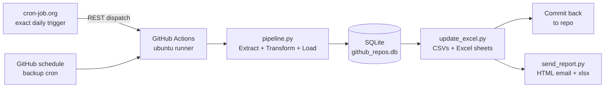

<div align="center">

# GitHub ETL Engine

**A fully automated data pipeline that tracks what is blowing up on GitHub.**
It pulls new repositories every day, scores them, stores them, rebuilds an Excel dashboard and emails you the report. No manual runs.

[](https://github.com/DishantBhere/GitHub-ETL-Engine-V2/actions/workflows/schedule.yml)


</div>

---

## What it does

Every day the pipeline asks the GitHub Search API for the most starred repositories created in the last 30 days, cleans and scores them, saves everything to SQLite, rebuilds the Excel dashboard, commits the fresh files back to this repo and sends a styled HTML report to your inbox.

You get:

- A live **Excel dashboard** (KPIs, top repos, language mix, velocity, topics, activity)
- Clean **CSV exports** in `data/`
- A queryable **SQLite database** (`github_repos.db`)
- A daily **HTML email** with the top 5, fastest risers and language mix, Excel attached

<!-- Add a screenshot: save it as docs/dashboard.png and uncomment -->
<!-- <p align="center"></p> -->

---

## How it works



| Stage | File | What happens |
|---|---|---|
| Extract | `pipeline.py` | Calls `GET /search/repositories` for repos created in the last `DAYS_BACK` days, sorted by stars |
| Transform | `pipeline.py` | Cleans fields, converts times to IST, adds derived metrics (below), handles duplicates |
| Load | `pipeline.py` | Writes the `repos` table in `github_repos.db` |
| Report | `update_excel.py` | Builds 6 summary tables, writes CSVs, refreshes the data sheets in the Excel workbook. The `Dashboard` sheet design is never touched |
| Notify | `send_report.py` | Sends the HTML email with the workbook attached |
| Orchestrate | `.github/workflows/schedule.yml` | Runs all of the above and commits the results |

### Derived metrics

| Metric | Meaning |
|---|---|
| `stars_per_hour` | Stars divided by repo age in hours. Measures how fast a repo is rising |
| `fork_ratio` | Forks divided by stars. Shows how much people build on it, not just bookmark it |
| `viral_level` | Tier from stars: Trending, Rising Star, Viral, Super Viral, Legendary, Iconic, Phenomenal, Hall of Fame |
| `age_days` / `age_hours` | Time since the repo was created |

---

## Scheduling design

GitHub's own `schedule` cron is best effort. In practice runs can start minutes or hours late, and sometimes get skipped. This project uses two triggers so a run always happens:

1. **Primary:** [cron-job.org](https://cron-job.org) sends a `POST` to the GitHub `workflow dispatch` API at an exact time.
2. **Backup:** the built in `schedule:` cron in the workflow file.

```
POST https://api.github.com/repos/DishantBhere/GitHub-ETL-Engine-V2/actions/workflows/schedule.yml/dispatches
Body: {"ref":"main"}
```

A `concurrency` group stops two runs from overlapping. If both triggers fire on the same day you may see two commits. That is harmless.

---

## Project structure

```
GitHub-ETL-Engine-V2/
├── .github/workflows/schedule.yml   # automation
├── pipeline.py                      # extract, transform, load
├── update_excel.py                  # CSVs + Excel data sheets
├── send_report.py                   # HTML email
├── build_template.py                # builds the dashboard template
├── run_all.py                       # one command to run everything locally
├── github_repos.db                  # SQLite database
├── GitHub_Trending_Dashboard.xlsx   # Excel dashboard
├── data/                            # CSV exports
│   ├── repos.csv
│   ├── languages.csv
│   ├── categories.csv
│   ├── velocity.csv
│   ├── topics.csv
│   └── activity.csv
└── requirements.txt
```

---

## Run it locally

```bash
git clone https://github.com/DishantBhere/GitHub-ETL-Engine-V2.git
cd GitHub-ETL-Engine-V2
pip install -r requirements.txt
python run_all.py
```

Then open `GitHub_Trending_Dashboard.xlsx`.

Optional environment variables:

| Variable | Default | Purpose |
|---|---|---|
| `DAYS_BACK` | `30` | How far back to look for new repos |
| `TIMEZONE` | `Asia/Kolkata` | Timezone for date and time columns |
| `DB_PATH` | `github_repos.db` | SQLite file location |
| `GITHUB_TOKEN` | none | Raises the API rate limit |

Preview the email without sending it:

```bash
DRY_RUN=1 STATUS=success TRIGGER=manual REPO=you/repo RUN_URL=https://example.com python send_report.py
```

This writes `email_preview.html`. Open it in a browser.

---

## Deploy your own copy

1. Fork or clone this repo.
2. Go to **Settings, Secrets and variables, Actions, Repository secrets** and add:

| Secret | Value |
|---|---|
| `MAIL_USER` | Gmail address that sends the report |
| `MAIL_PASS` | Gmail **app password** (16 characters, needs 2 Step Verification) |
| `MAIL_TO` | Address that receives the report |

3. Go to **Settings, Actions, General, Workflow permissions** and choose **Read and write permissions**.
4. Open the **Actions** tab, pick **Daily GitHub ETL**, click **Run workflow** once to test.
5. For an exact schedule, create a cron-job.org job that calls the dispatch URL above.
   - Header `Authorization: Bearer <fine grained token>`
   - Header `Accept: application/vnd.github+json`
   - Header `X-GitHub-Api-Version: 2022-11-28`
   - Header `Content-Type: application/json`
   - Token scope: only this repo, **Actions: Read and write**

Never commit tokens or passwords. Keep them in Secrets or in the cron-job.org header field.

---

## Troubleshooting

| Problem | Likely cause and fix |
|---|---|
| Scheduled run never starts | GitHub cron delay or skip. Use the cron-job.org trigger |
| Dispatch returns `401` | Token expired or `Bearer ` prefix wrong |
| Dispatch returns `404` | Wrong repo or workflow file name, or token does not cover the repo |
| Email step shows `len: 0` | Secrets missing in this repo, or name typo |
| `SMTPAuthenticationError` | Wrong Gmail app password |
| Commit step fails on push | Someone pushed the `.db` or `.xlsx` by hand at the same time. Pull first |

---

## Roadmap

- [ ] Daily snapshot history table for week over week star growth
- [ ] Skip run if today is already loaded
- [ ] Data quality checks before commit
- [ ] Unit tests in CI
- [ ] Live web dashboard
- [ ] Telegram or Discord daily digest

---

## Tech stack

Python, requests, pandas, openpyxl, SQLite, GitHub Actions, GitHub REST API, SMTP, cron-job.org

---

## License

See [LICENSE](LICENSE).

<div align="center">

Built by [Dishant Bhere](https://github.com/DishantBhere)

</div>
